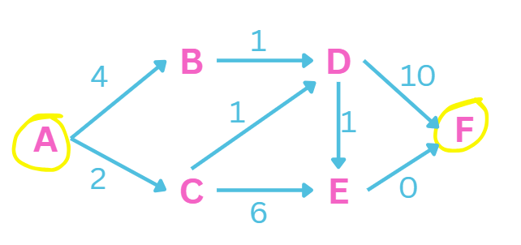

# Dykstra Shortest Path

## *Lecture 10-26-26*

```rust
shortest_path(g: Graphspec, src: nat, dst: nat) -> Option(Seq<nat>)

lemma_shortest_path: 
    none -> no path 
    some(p) -> shortest path 
```



|     | A | B | C | D | E | F |
|-----|---|---|---|---|---|---|
| S-0 | 0 | - | - | - | - | - |

S = settled 

{A} 0 4 2 - - - 

{A, C} 0 4 2 3 8 _

{A, C, D} 0 4 2 3 4 13


A: [A]

B: [A, B]

C: [A, C]

D: [A, C, D]

E: [A, C, D, E]

F: [A, C, D, E, F]

## *Lecture 10-28-26*

### Options

`Options(some(w) (some nat number) | None = null)`

### Trigger

* need to tell SMT solver what values to enumerate 
* usually attached to a function
* form of universal insanitation 
* knows to enumerate, doesn't know which values to instantiate 
* gap between a and c too big, need to instantiate what's in-between a and c
    * a -> ... -> c
    * instantiate ...

```rust
forall|u:nat, v:nat| (#[trigger] (self.e(u,v)).is_some()) ==> u < self.n && v < self.n 
```

## *Lecture 11-4-26*

### Spec Invariant

define a function called invariant

invariant: pick and settle, then run must preserve the invariant

1. src < graph.n
2. state.best(src) = [src]
3. forall v in s, graph.is_shortest_path(state.best(v)) (everything that's settled is the shortest path)
4. forall v, 0 <= v < graph.n && state.best(v.is_some()) ==> graph.is_path_from_to(state.best(v).unwrap src, v) (best for any node is path from src to that node)
5. forall i,j 
    * i is a node in settled s 
    * j is a node outside of settled s
    * if i,j then:
      * state.best(j).is_some()
      * graph.cost(state.best(j).unwrap())
      * graph.cost(i) + graph.edge(i, j)
    * 1. selection, 2. relaxing 
      * to show preserve the invariant, have to show select always choose least cost canditate 
      * relaxing, everything satififies 5