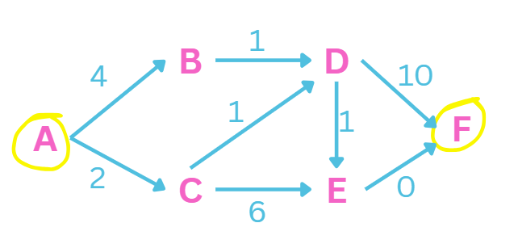

# Dykstra Shortest Path

*Lecture 10-26-26*

```rust
shortest_path(g: Graphspec, src: nat, dst: nat) -> Option(Seq<nat>)

lemma_shortest_path: 
    none -> no path 
    some(p) -> shortest path 
```



| | A | B | C | D | E | F |
|--|---|---|---|---|---|---|
| S-0| 0 | - | - | - | - | - |

S = settled 

{A} 0 4 2 - - - 

{A, C} 0 4 2 3 8 _

{A, C, D} 0 4 2 3 4 13


A: [A]

B: [A, B]

C: [A, C]

D: [A, C, D]

E: [A, C, D, E]

F: [A, C, D, E, F]